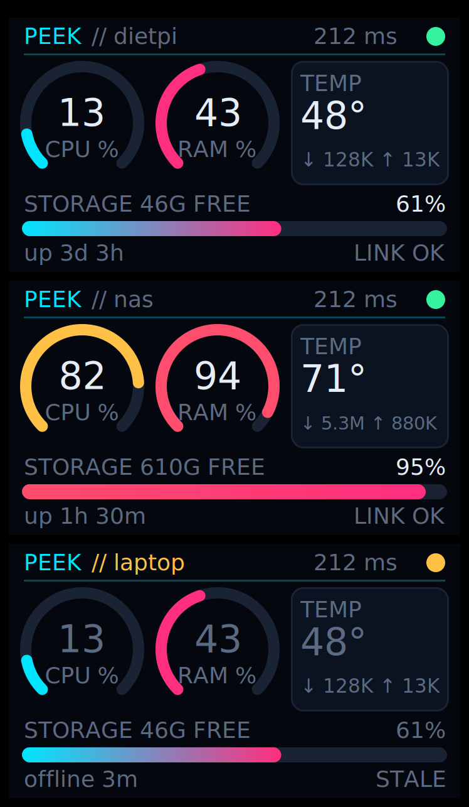

# PeekESP for Home Assistant

Your PeekESP machines as Home Assistant entities, plus a Lovelace card that
draws **the device's own screen** on a dashboard: same palette, same layout,
same gauges, same load colours, same 500 ms sweep.



It reads the same Cloudflare relay the ESP32 reads. Nothing is added to the
device, nothing needs to be opened on your network, and no firmware change is
required.

## Install

**With HACS** (and the Marketplace in Home Assistant 2026.11 and later):

1. Open HACS, menu, **Custom repositories**, add
   `https://github.com/rhshourav/hass-peekesp` as type **Integration**.
   (Once it is in the default catalog you can just search for *PeekESP*.)
2. Download **PeekESP** and restart Home Assistant.

[](https://my.home-assistant.io/redirect/hacs_repository/?owner=rhshourav&repository=hass-peekesp&category=integration)

**Manually:** copy `custom_components/peekesp` into your config folder and
restart.

Then:

3. **Settings → Devices & services → Add integration → PeekESP**.
   - *Pairing code*: the code your agent was set up with (the one the device
     showed on first boot). Dashes optional.
   - *Relay URL and token*: for a named or private stream.
4. Add the card. It is loaded automatically; pick **PeekESP screen** in the
   card picker, or in YAML:

```yaml
type: custom:peekesp-card
entity: sensor.dietpi_screen
name: Pi            # optional, replaces the host name after "//"
```

One card per machine. For a wall of them:

```yaml
type: grid
columns: 2
square: false
cards:
  - { type: custom:peekesp-card, entity: sensor.dietpi_screen }
  - { type: custom:peekesp-card, entity: sensor.nas_screen }
```

## What you get

Per machine (a device named after the host): CPU, RAM, storage used / free /
total, temperature, download, upload, uptime, battery and charging (only on
machines that report one), a *Reporting* connectivity sensor, and the
**Screen** sensor the card reads. On the relay device: latency and the newest
published firmware version. Machines appear on their own when they first
report.

## How the card tells you what is wrong

It uses the device's three link states, and the readings dim when they are old.

| Shows | Meaning |
|---|---|
| `LINK OK` (green) | the relay heard from the machine within the offline window |
| `STALE` (amber), `offline 3m` | relay reachable, machine stopped pushing |
| `NO LINK` (red) | Home Assistant cannot reach the relay; last values stay, dimmed |

## Options

*Poll interval* (default 10 s, minimum 5) and *Mark offline after* (default
30 s). The device polls the same Worker every 5 s, so every HA poll counts
against the same request quota. The `Screen` sensor changes on every poll; if
you care about database size, exclude `sensor.*_screen` from the recorder.

## Differences from the glass

- The throughput line shrinks (never below 9 px) instead of clipping, which
  is what the device does when "↓ 5.3M ↑ 880K" is wider than its panel.
- The ping figure is Home Assistant's round trip to the relay, not the
  device's.
- Montserrat is used if installed, otherwise the system sans-serif.

## Tests

```
python3 tests/test_core.py        # pairing vector, parsing, client vs a fake relay
node tests/test_card.js           # needs: npm i jsdom
```

## What has and has not been verified

Verified here: the pairing derivation against the vector pinned in
`PeekESP.ino`; payload parsing including the firmware's sentinels; the relay
client against a fake server; the card's logic across online / stale /
unavailable / missing; the card's rendering, rasterised outside a browser.

**Not verified: running inside a real Home Assistant.** The integration
compiles and follows current APIs (2025.1+), but no HA instance was available,
and the card has not been seen in a real browser. Treat 0.1.0 accordingly.
