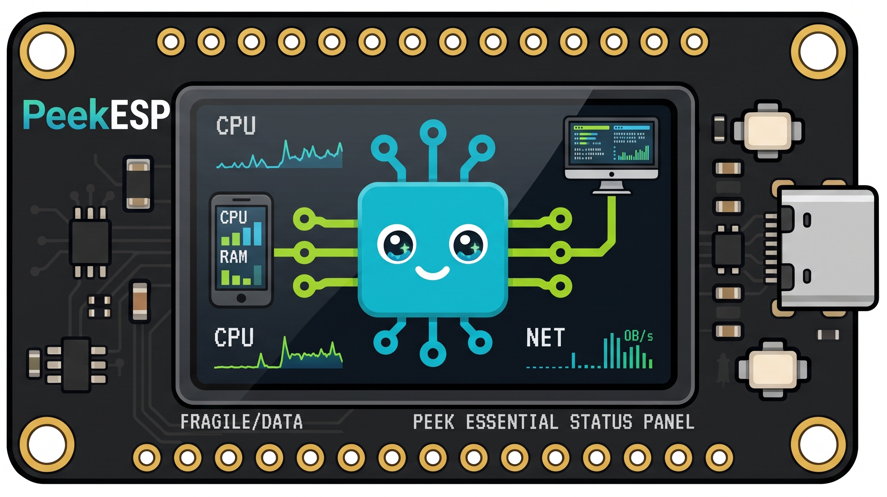
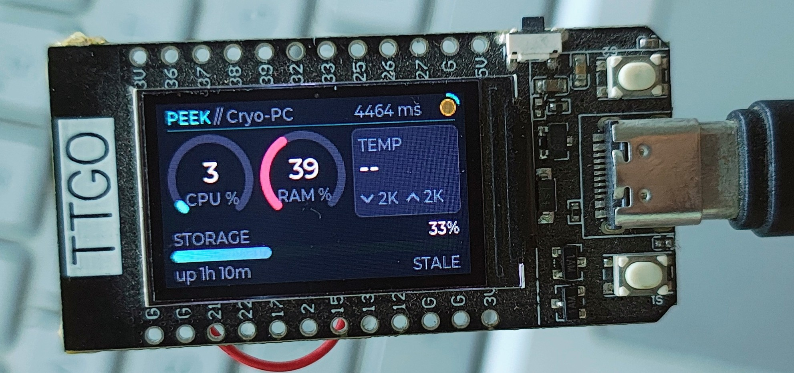
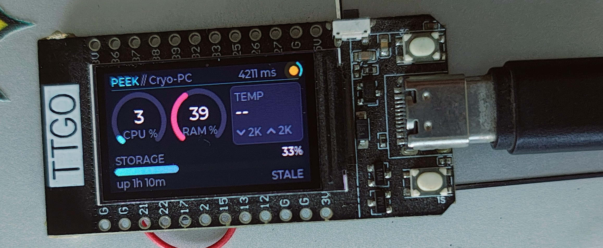
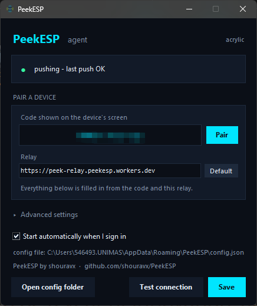
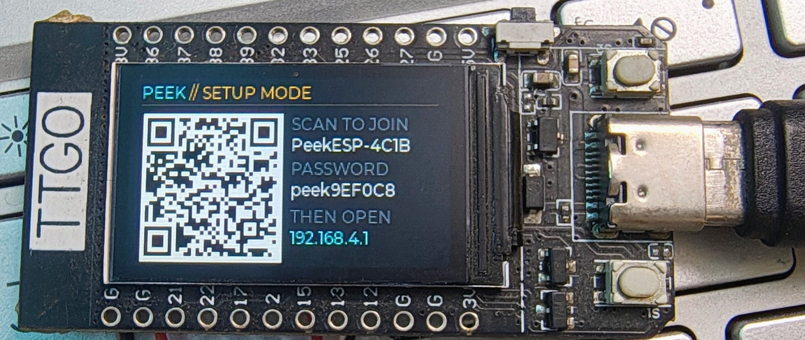

<div align="center">



# PeekESP
Peek Essential Status Panel

**Cross-platform system monitoring — from Android home-screen widgets to dedicated ESP32 displays.**




<sub>Live CPU, RAM, storage and throughput for a machine on the other side of the internet.</sub>

</div>

PeekESP brings remote system metrics to Android, dedicated ESP32 displays, desktop hosts, Raspberry Pi displays, and Home Assistant. Monitor CPU, memory, storage, temperature, uptime, and network throughput across your devices — without making the ESP32 the only way to use PeekESP.

## Choose your path

| I want to… | Start here |
|---|---|
| Check a machine from my phone | [Android app](#android-app) |
| Build the ESP32 desk display | [Quick start](#quick-start) |
| Use a Raspberry Pi and a small screen | [Raspberry Pi](#a-raspberry-pi-instead-of-an-esp32) |
| See machines in Home Assistant | [Home Assistant](#home-assistant) |
| Monitor one more machine | [Setup → the agent](#1-on-the-host--the-telemetry-agent) |

| Platform | Role | Status |
|---|---|---|
| Android | Viewer — app and home-screen widget | [Android app](#android-app) |
| ESP32, TTGO T-Display | Display | Verified on hardware |
| ESP32, other panels | Display | Compiles and links; not yet run on hardware |
| Raspberry Pi | Display and/or agent | [pi/](pi/) |
| Windows | Agent (tray app) | Supported |
| Linux / DietPi | Agent | Supported |
| macOS | Agent |
| Home Assistant | Viewer | HACS integration |

<details>
<summary><b>Contents</b></summary>

- [Android app](#android-app)
- [Quick start](#quick-start)
- [What's in here](#whats-in-here)
- [Architecture](#architecture)
- [Why a relay](#why-a-relay)
- [Get it](#get-it)
- [Setup](#setup)
- [Other screens, other hosts](#other-screens-other-hosts)
- [Configuration](#configuration)
- [Changing the boot logo](#changing-the-boot-logo)
- [Buttons](#buttons)
- [Clock](#clock)
- [Power screen](#power-screen)
- [Telemetry contract](#telemetry-contract)
- [Troubleshooting](#troubleshooting)
- [FAQ](#faq)
- [Privacy and security](#privacy-and-security)
- [Contributing](#contributing)
- [License](#license)

</details>

## Android app

<div align="center">

</div>

PeekESP for Android is a viewer — an app plus a home-screen widget — and it works **with or without an ESP32**. It reads the same relay as every other client, so a phone, a desk display and Home Assistant can all watch the same machines at once.

| | |
|---|---|
| **Download** | The `.apk` under **Assets** on the [latest release](https://github.com/rhshourav/PeekESP/releases/latest) · Google Play: coming soon |
| **Requires** | Android 8.1 (API 27) or newer |
| **Also needs** | A PeekESP network code, and at least one machine running the [agent](#1-on-the-host--the-telemetry-agent) |

Until the Play Store listing is live, the app is installed from the APK. Open the latest release, expand **Assets** and download the `.apk`. Android will ask you to allow *Install unknown apps* for whichever app opened the file (your browser or file manager); switch that permission off again afterwards.


### Get started

1. Open the app and choose **Join** or **Create**.
2. **Join an existing network** — type the code, e.g. `K7M2-P4QX-9R`. Dashes and case are ignored. Use this when an ESP32 is already showing a code or your agents are already paired.
3. **Create a new network** — the app generates a fresh code. Give that same code to each agent: `sudo peekesp pair CODE` on Linux, or **Settings → Pair a device** in the Windows app. 
4. Add the widget: long-press the home screen → **Widgets** → **PeekESP**, then drag it into place.
A code identifies you, not a machine. Every machine run with the same code appears in the app, up to six.

### What the widget shows

Key readings at a glance, without opening the app: CPU and RAM usage, storage, temperature, network throughput, uptime and link status — whichever of them the monitored machine actually reports.

**Several machines.**
### Refresh rate and the request budget

Every refresh is a poll against the relay, counted the same way as a display's. An always-polling client at a 5 s interval costs 17,280 requests a day, and the free tier allows 100,000 — see the [budget](#2-deploy-the-relay). Android limits background work, so widgets refresh far less often than that. If you run several phones or widgets, count them in.

What the app stores on the phone and which permissions it asks for are covered in [Privacy and security](#privacy-and-security).

## Quick start

This is the ESP32 + Windows route. Phone only? Jump to the [Android app](#android-app).

```bash
python quickstart.py
```

Builds the Windows app and flashes the board with the firmware committed in
[firmware/](firmware/). **No Arduino IDE, no ESP32 core, no libraries, no
toolchain** — the only download is esptool, about 3 MB. Then:

1. The device shows a pairing code, like **`K7M2-P4QX-9R`**
2. Run `windows/dist/PeekESP.exe` → tray icon → **Settings**
3. Type the code into **Pair a device** → **Pair** → **Save**

That is the whole setup. **No account, no token, no port forward, no VPN** — the
device and the app derive everything else from the code, and the relay never
sees it.

Only planning to *change* the firmware? `python quickstart.py --dev` installs the
Arduino toolchain and builds from source instead.

<div align="center">
  


</div>

Two arcs for CPU and RAM, a panel for temperature and throughput, a storage bar
with the free space beside it, and a status line that names what the link is
doing rather than leaving you to guess.

## What's in here

| Path | What it is |
|---|---|
| [android/](android/) | The Android app and home-screen widget. **[TODO: confirm folder name]** |
| [PeekESP/PeekESP.ino](PeekESP/PeekESP.ino) | The firmware. Open this one in the Arduino IDE. |
| [PeekESP/secrets.example.h](PeekESP/secrets.example.h) | Optional factory defaults. Real config happens on-device. |
| [PeekESP/PANELS.md](PeekESP/PANELS.md) | Building for a different screen — ILI9341, ST7789, GC9A01 round, ST7735. |
| [lv_conf.h](lv_conf.h) | LVGL config for this board. |
| [platformio.ini](platformio.ini) + [main.cpp](main.cpp) | PlatformIO build of the exact same sketch, one env per panel. |
| [pi/](pi/) | The same dashboard on a Raspberry Pi — colour TFT, OLED, e-paper, 16×2 LCD, LED matrix. |
| [custom_components/peekesp/](custom_components/peekesp/) | Home Assistant integration. Sensors per machine, buttons for the display. |
| [dietpi/peek-agent.py](dietpi/peek-agent.py) | Run on the Linux host: serves the JSON, and/or pushes it to the relay. |
| [windows/](windows/) | The same agent for a Windows PC, plus a one-file `.exe` build. |
| [cloudflare/](cloudflare/) | Worker relay for when the host has no reachable port. `npm test` covers it. |
| [.github/workflows/](.github/workflows/) | CI: tests the Worker, deploys it on merge, pings it weekly. |
| [tools/png_to_lvgl.py](tools/png_to_lvgl.py) | Turns a PNG into the compiled-in boot logo. |
| [tools/make_icon.py](tools/make_icon.py) | Builds the multi-resolution Windows `.ico` from the logo. |
| [quickstart.py](quickstart.py) | Install, build and flash in one command. |
| [tools/setup_arduino.py](tools/setup_arduino.py) | Installs the core and every library, patched and pinned. |
| [firmware/](firmware/) | The compiled firmware, ready to flash. No toolchain needed. |
| [tools/flash.py](tools/flash.py) | Flashes it and opens the serial monitor. No IDE. |
| [tools/export_firmware.py](tools/export_firmware.py) | Rebuilds that image after a firmware change. |
| [docs/ARCHITECTURE.md](docs/ARCHITECTURE.md) | Design notes: why the firmware is built the way it is. |

## Architecture

Two pinned FreeRTOS tasks that share nothing but a mutex-guarded struct:

- **Core 0** — WiFi → NTP → a blocking `HTTPS GET` → JSON parse. Everything here
  is allowed to stall for seconds at a time. It also samples the battery ADC,
  filters it and works out the charge state, in the gaps between polls where it
  would otherwise just be asleep.
- **Core 1** — `lv_timer_handler()` and nothing else. It never opens a socket
  and never waits on hardware, so a slow link cannot drop a frame. It picks up
  new data by watching a sequence counter and takes the mutex with a zero
  timeout, so even a contended lock just defers the update to the next tick
  rather than blocking the UI.

Two details worth knowing: battery sampling lives on core 0 so the UI thread never
blocks on an ADC read, and core 1 sleeps for however long LVGL says the next timer
is due (clamped to 2–30 ms) instead of a flat 5 ms. Gauges animate over 500 ms on a
0–1000 range so small changes still read as a sweep. The reasoning is in
[docs/ARCHITECTURE.md](docs/ARCHITECTURE.md).

## Why a relay

The hard part of this project isn't the display — it's that **something has to
accept an inbound connection**, and the ESP32 can only dial out.

A plain WireGuard tunnel solves that, and this project used to do it, but the
tunnel has to terminate on the monitored host. Behind CGNAT, or on a network you
don't administer, that option doesn't exist. Pushing through a Cloudflare Worker
instead means **both ends only ever dial out**, which works everywhere the
tunnel did and everywhere it didn't.

An ESP32 also can't join a Tailscale network, which is the other thing people
reach for: Tailscale is WireGuard plus a control plane — node registration,
rotating keys, NAT traversal, DERP relays — and none of that has an embedded
client.

The relay has three modes, all on one deployment:

| | **Paired** | **Private** | **Shared** |
|---|---|---|---|
| Setup | type the device's code | two Worker secrets | one `MASTER_SECRET` |
| Worker config | **none** | `PUSH_TOKEN` + `READ_TOKEN` | mint per stream |
| For | just working | only you | you and other people |

## Get it

| | |
|---|---|
| **This repository** | [Download ZIP](https://github.com/rhshourav/PeekESP/archive/refs/heads/main.zip) &middot; `git clone https://github.com/rhshourav/PeekESP.git` |
| **Android app** | [Releases](https://github.com/rhshourav/PeekESP/releases) &middot; see [Android app](#android-app) |
| **Windows app** | build it: `cd windows && python build.py` &rarr; `dist/PeekESP.exe` |
| **Arduino IDE** | [arduino.cc/en/software](https://www.arduino.cc/en/software) |
| **Python 3** | [python.org/downloads](https://www.python.org/downloads/) — needed only for the setup scripts and the agent |

**Nothing else to download.** The compiled firmware is committed at
`firmware/PeekESP-merged.bin` (1.25 MB), so flashing needs no core, no libraries
and no toolchain — `tools/flash.py` fetches only esptool, ~3 MB.

```bash
python tools/flash.py              # flash the committed image, then watch serial
python tools/flash.py --erase      # also wipe settings, for a fresh pairing code
```

To modify the firmware you do need the toolchain, and one command installs all
of it at the pinned versions, patched:

```bash
python tools/setup_arduino.py      # ~250 MB, once
python tools/export_firmware.py    # rebuild the committed image after a change
```

`setup_arduino.py --check` reports what is installed without changing anything.
Everything lands in the normal Arduino folders, so the Arduino IDE sees it too
if you prefer to work there.

<details>
<summary>If you would rather install them by hand</summary>

| | Version | Where |
|---|---|---|
| ESP32 core | **2.0.17** | Boards Manager, or [package_esp32_index.json](https://espressif.github.io/arduino-esp32/package_esp32_index.json) |
| lvgl | **8.3.9** — not 9.x | [github.com/lvgl/lvgl](https://github.com/lvgl/lvgl/releases/tag/v8.3.9) |
| TFT_eSPI | 2.5.43 | [github.com/Bodmer/TFT_eSPI](https://github.com/Bodmer/TFT_eSPI) |
| ArduinoJson | 7.4.3 | [arduinojson.org](https://arduinojson.org/) |

Then two edits the script would have done for you: in
`<Arduino>/libraries/TFT_eSPI/User_Setup_Select.h` comment out
`#include <User_Setup.h>` and uncomment the `Setup25_TTGO_T_Display.h` line, and
copy this repo's `lv_conf.h` to `<Arduino>/libraries/lv_conf.h` — *beside* the
`lvgl` folder, not inside it.

The libraries are not committed to this repository because LVGL alone is 97 MB
across 1160 files and TFT_eSPI another 34 MB; and LVGL finds `lv_conf.h` by
looking one directory *above* its own folder, which cannot work from inside a
sketch without build flags the Arduino IDE has no way to set.

</details>

## Setup

### 1. On the host — the telemetry agent

**Linux / DietPi — one line.** Flash the device first so it has a code to show
you, then:

```bash
curl -fsSL https://raw.githubusercontent.com/rhshourav/PeekESP/main/dietpi/install.sh | sudo sh
```

It asks for the pairing code and derives everything else — relay URL, stream,
push token — locally. Then it installs a hardened systemd service, starts it,
and waits to confirm the machine is actually pushing before it says it worked.

Afterwards everything is managed with the `peekesp` command it installs —
`peekesp status`, `peekesp logs -f`, `peekesp test`, `sudo peekesp pair CODE`,
`sudo peekesp set interval 15`, `sudo peekesp uninstall`. Full detail in
[dietpi/](dietpi/).

To skip the prompt, or to run it from a script:

```bash
curl -fsSL https://raw.githubusercontent.com/rhshourav/PeekESP/main/dietpi/install.sh | sudo sh -s -- K7M2-P4QX-9R
```

Piping a script from the internet into a root shell means trusting whatever is
at that URL. Read it first if you would rather — that is the honest advice, not
a formality:

```bash
curl -fsSLO https://raw.githubusercontent.com/rhshourav/PeekESP/main/dietpi/install.sh
less install.sh && sudo sh install.sh
```

**Windows** — same JSON, same fields, standard library only. See
[windows/](windows/). Once the [winget submission](packaging/winget/README.md)
lands:

```powershell
winget install rhshourav.PeekESP
```

Until then, grab the zip from [Releases](https://github.com/rhshourav/PeekESP/releases),
or run it from source:

```bash
python windows\peek_agent_win.py --once
```

If Windows shows *Windows protected your PC* when you run a downloaded `PeekESP.exe`, the release isn't code-signed: choose **More info → Run anyway**, or build it yourself with `cd windows && python build.py`.

Check it reads your machine correctly before wiring anything up — run it in the
foreground and, from another shell:

```bash
curl http://localhost:8080/telemetry
```

You should get real numbers.

### 2. Deploy the relay

```bash
cd cloudflare
npm install -g wrangler && wrangler login
npx wrangler deploy
```

That is the whole deployment. **Pairing needs no secrets on the Worker at all** —
the device and the app derive their stream and tokens from the pairing code
locally, and the Worker never sees it. `/health` reporting
`"configured": false` is the expected state.

`PUSH_TOKEN` / `READ_TOKEN` (private) and `MASTER_SECRET` (named streams) are
only for the other two modes — see [cloudflare/](cloudflare/).

Deploys can run themselves: add a `CLOUDFLARE_API_TOKEN` secret and the
[workflow](.github/workflows/cloudflare-worker.yml) tests every change to
`cloudflare/**`, deploys on merge to `main`, and health-checks weekly.

> Free-tier note: this uses a **Durable Object**, not Workers KV. KV's free tier
> allows 1,000 writes/day and a 5-second push interval is 17,280 — it would fail
> partway through day one.
>
> Requests are what you actually budget. At a 5-second interval each agent costs
> 17,280 pushes/day and each display costs 17,280 polls/day, against a 100k/day
> allowance. So **one display plus four machines fits (86,400); a fifth tips it over
> (103,680).** Every phone or widget that polls counts as another display. A display
> polls once no matter how many machines it shows — the cost is per *agent*, not per
> screen you swipe to. Raising the interval to 15 s divides everything by three.
>
> The limit of six machines per code comes from the relay, not the free tier: six
> agents plus one display is 120,960 requests a day at 5 s, or 40,320 at 15 s. Past
> four machines, raise the interval.

### 3. Pair the device

Flash the sketch, and the ESP32 shows a code like **`K7M2-P4QX-9R`**. Open the
Windows app, right-click the tray icon → **Settings**, type the code into
**Pair a device**, press **Pair** then **Save**.

<div align="center">

</div>

Everything below the code is filled in from it. The status line at the top says
what the agent is actually doing, so "did it work" is answered on the same
screen where you typed the code.

That is the entire configuration. The relay URL, the stream and both tokens are
derived from the code on both sides; dashes and case are ignored. The device
stops showing the code as soon as the first reading arrives.

On Linux the one-liner in step 1 already took the code and installed the
service, so there is nothing to do here. On Windows the tray app's **Start
automatically when I sign in** does the same with no service to install.

**Run the same command on every machine you want to watch, with the same code.**
A pairing code identifies you, not a machine: a Windows box, a Linux laptop and a DietPi
sharing one code all appear on the display, and the left button swipes between
them. Six per code — see the [request budget](#2-deploy-the-relay) before adding many.

### 4. Flashing the ESP32

```bash
python tools/flash.py
```

Finds the board, writes `firmware/PeekESP-merged.bin`, and opens the serial
monitor so you can read the pairing code as it boots. `--erase` wipes saved
settings, which is how you get a *new* pairing code — re-flashing alone keeps
the old one, because it lives in NVS and survives a firmware update.

`--build` compiles from source instead, if you have the toolchain.

Prefer the Arduino IDE? Everything is already installed and patched: open
`PeekESP/PeekESP.ino`, set **Board: LilyGo T-Display** and **Tools → Partition
Scheme → Huge APP**, upload. *ESP32 Dev Module* also works; both are verified.

**Verified build** — ESP32 core 2.0.17, lvgl 8.3.9, ArduinoJson 7.4.3,
against **both** TFT_eSPI builds:

| TFT_eSPI | Flash | Result |
|---|---|---|
| LilyGO 2.2.20 (preconfigured) | 1,234,601 B | clean, no warnings |
| Library Manager 2.5.43 | 1,238,797 B | clean, no warnings |

The sketch only uses `init` / `setRotation` / `fillScreen` / `startWrite` /
`setAddrWindow` / `pushColors` / `endWrite`, all stable across that version gap.

```
Sketch uses 1234601 bytes (39%) of program storage space.
Global variables use 119748 bytes (36%) of dynamic memory.
```

That 39 % is with **Huge APP**. On the default 1.2 MB partition it's **94 %** —
it still fits, but there's nothing left, so set *Tools → Partition Scheme →
Huge APP (3MB No OTA/1MB SPIFFS)*.

### 4b. Flashing the ESP32 — PlatformIO

You can skip the two manual edits in [Get it](#get-it) (`User_Setup_Select.h` and `lv_conf.h`): `platformio.ini` supplies the TFT_eSPI pinout and
the LVGL config path as build flags, which is why PlatformIO never had the
`User_Setup_Select.h` problem in the first place. Then:

```bash
pio run -t upload -t monitor
```

## Other screens, other hosts

The T-Display is the default, not the only option. Everything below reads the
same relay with the same pairing code, so they can all run at once — a device
at a relative's place, one on your desk, and Home Assistant watching both.

### A different screen on the ESP32

Each panel has its own prebuilt image. Flashing needs no toolchain:

```bash
python tools/flash.py --panel gc9a01-round       # 1.28" circular
python tools/flash.py --panel ili9341-320x240    # 2.4"/2.8" colour TFT
python tools/flash.py --panel st7789-240x240     # 1.3" square
```

One image per panel — TFT_eSPI decides its driver, pins and geometry
at compile time, so a firmware image drives exactly one screen and the
T-Display's image shows nothing on a GC9A01. The dashboard's layout is derived
from the panel's dimensions rather than hardcoded, so adding another is a
build flag and not a redraw.

To build them yourself: `python tools/build_panels.py`. Full list, wiring, and
what to change when it comes up sideways:
**[PeekESP/PANELS.md](PeekESP/PANELS.md)**.

Only the T-Display has run on hardware. The rest compile and link with the right
driver and the pins written down in `platformio.ini`, and that is the whole
claim.

### A Raspberry Pi instead of an ESP32

```bash
curl -fsSL https://raw.githubusercontent.com/rhshourav/PeekESP/main/pi/install.sh | sudo sh
```

Drives every panel above *plus* the ones the firmware cannot: SSD1306 OLED,
Waveshare e-paper, a 16×2 character LCD and a MAX7219 LED matrix. Those last
three are not framebuffers — 32 character cells, or 8 rows of dots — so they
get their own presentation rather than a shrunken dashboard.

`peek-display --self-test` draws a pattern that proves the wiring before you
blame the software. **[pi/README.md](pi/README.md)**.

A Pi can be both ends at once: run [the agent](dietpi/) alongside and it appears
in its own carousel.

### Home Assistant

Add `https://github.com/rhshourav/PeekESP` to HACS as an **Integration**, then
pair with the same code. One device per monitored machine — CPU, memory,
storage, temperature, throughput, battery, last boot — plus buttons that drive
the ESP32 display: identify, refresh, wake, standby, reboot.

**[custom_components/peekesp/README.md](custom_components/peekesp/README.md)**.

## Configuration

There is no compile-time setup. A freshly flashed device has no WiFi
credentials, so it boots straight into **setup mode**: it raises its own access
point and the screen shows a QR code.

<div align="center">

</div>

1. Scan the QR with a phone camera — it encodes a `WIFI:` join string, so the
   phone joins the AP directly. No typing the generated password off a 1.14"
   panel.
2. The captive portal opens the form (or browse to `192.168.4.1`).
3. Type your WiFi into **Network 1**. The box autocompletes from a live scan,
   strongest first, with signal strength and a padlock — but it only *suggests*,
   so a hidden network is just a name you type rather than a separate box and
   the JavaScript to reveal it. **Scan again** re-runs the scan.
4. **Save & Reboot** — settings go to NVS and survive reflashing the sketch.

To change something later, hold the **left button for 1.5 s**; the device
reboots into setup mode. Holding it during power-on does the same, which is the
way back in if you typo the WiFi password. "Erase all settings" at the bottom of
the form returns the device to factory defaults.

### What else is on that page

**Five networks.** The device scans on boot and joins whichever of the five it
can actually hear, strongest first, splitting its connect budget across the
candidates — so a wrong password in slot 1 cannot starve the others. A spare
costs nothing until the day you move the device.

**Time zone and location label.** Stored in *minutes* east of UTC, because
Kathmandu is +5:45 and Adelaide is +9:30 and an hours-only field silently
cannot express either. The label is what the clock page prints above the time
and changes nothing else. There's a 24-hour toggle beside it.

**New pairing code.** Generates a fresh one and reboots so the device can show
it. It also clears the derived URL and token, since a new code means a new
stream and the old ones now point somewhere nothing will ever push. It asks for
confirmation, because every machine already paired stops reaching the device
until you retype the new code into each of them.

**Settings page on my network** — off by default. With it on, this same page is
reachable at the device's address on your WiFi. See below.

> The portal serves plain HTTP over its own WPA2 link — your WiFi passphrase
> crosses that link unencrypted. TLS would need a certificate no phone would
> trust, and the alternative is entering a 48-character token with two
> buttons. The AP is only up while you are configuring it, and its password is
> derived per-device from the MAC.

### The settings page on your network

Off by default, and worth understanding before turning it on.

With it enabled the device serves the same settings form at its address on your
WiFi, permanently — so you can change things without holding a button and
rejoining an access point. It asks for a password: user **peek**, the setup
password shown on the device's screen.

That is HTTP Basic over plain HTTP. It stops the other devices on your network
and the neighbour on your guest WiFi. It does **not** stop anyone who can watch
the traffic. Saying so plainly matters, because a control whose limits are not
stated gets trusted past them.

Two things the page never renders, whether it is on the AP or on your LAN:

- **WiFi passwords.** A `type=password` input still carries its value in the
  page source, so echoing the saved one back would hand it to anything that can
  fetch the page. The field shows `unchanged` as a placeholder and blank means
  "leave the saved one alone".
- **The read token**, for the same reason — it is what lets someone read your
  machine's telemetry.

The pairing code is never in the page at all. It exists on the device's screen
and nowhere else.

## Changing the boot logo

The device shows the logo for about a second at boot, then fades it out while
the network is already connecting underneath — the splash costs no boot time,
it just covers the moment the dashboard would otherwise show a screen of zeroes.

`PeekESP/logo_splash.h` is generated, not hand-written. To use different
artwork:

```bash
python tools/png_to_lvgl.py img/logo.png PeekESP/logo_splash.h --name logo_splash --size 96 --bg 05070E
```

It composites transparency onto the theme background (`--bg`), scales to fit
`--size`, and emits RGB565 in the byte order the firmware's `LV_COLOR_16_SWAP`
setting expects. At 96×96 that is 18 KB of **flash** — the image is `const`, so
it costs no RAM at all.

Alpha is flattened rather than kept: `LV_IMG_CF_TRUE_COLOR_ALPHA` would be 3
bytes per pixel and blend every frame, and the splash only ever sits on one
colour. Pass `--swap` if you ever set `LV_COLOR_16_SWAP` to 1 — the symptom of
getting it wrong is swapped red and blue, not an error.

## Buttons

Both buttons do two things, chosen by how long you hold them.

| Button | Action |
|---|---|
| Left (GPIO 0) — tap | Next page — each machine in turn, then the clock, then the power screen, then back to the first |
| Left — hold 1.5 s | Reboot into setup mode |
| Left — held at power-on | Boot straight into setup mode |
| Right (GPIO 35) — tap | Cycle backlight brightness — 100 / 59 / 27 / 8 %, remembered across reboots |
| Right — hold 1.2 s | Standby — panel off and polling paused |
| Right — press while in standby | Wake, back to the page you left |

Swiping costs nothing: one poll already carried every machine and the power
page is local, so the device makes the same number of requests whether you look
at one screen or at all of them.

**Standby, not deep sleep.** Standby keeps RAM, the WiFi association and the page you
were on, so waking is instant and you don't lose your place. The cost: it draws
milliamps rather than microamps, which suits a mains-powered desk gadget but not a
month on a battery. [Why not deep sleep?](docs/ARCHITECTURE.md#standby-instead-of-deep-sleep)

## Clock

Local time, swiped to like any other page. It follows the time zone you set in the setup form (stored in minutes east of UTC); the factory default is Dhaka, UTC+6, no daylight saving . It shows a
12-hour clock with seconds, an AM/PM marker, the weekday and the full date, and
a bar that fills across the minute so the page never looks frozen. It lives in
[`PeekESP/clock_faces.h`](PeekESP/clock_faces.h) so the face can be redesigned
without reading past a thousand lines of networking.

The time comes from the NTP sync the TLS handshake needed anyway. The board has
no battery-backed RTC — the internal one keeps counting between syncs but
drifts, and loses everything on a power cut — so it shows `--:--` until the
first sync lands, rather than 01:00 on 1 January 1970, which is what an unsynced
ESP32 sincerely believes.

## Power screen

The last page of the swipe carousel. Tap the left button past the last machine
and you land on it: the board's own charge level and voltage, whether something
is holding it up, and — on the line below — the battery of whichever machine you
were just looking at.

It never appears on its own. Charging uses hysteresis: the state has to climb past
4.32 V to count as charging and fall below 4.20 V to stop, so a reading that wobbles
inside that band changes nothing. [History](docs/ARCHITECTURE.md#why-the-power-screen-never-pops-up)

Two different batteries are on this page. The big one is the **ESP32's own**
cell on the JST connector, read through a 1:2 divider on GPIO 34 behind a MOSFET
gated by GPIO 14 — worth knowing, because leaving that pin low reads a floating
node, which looks like a flat battery rather than like a measurement that never
happened. The line underneath is the **monitored machine's** battery, which the
agent reports; a desktop says `no battery` there rather than showing an empty
one.

**What it can and cannot tell you.** The T-Display exposes no charge-status
pin, so the state is inferred from voltage. A Li-ion cell off charge never sits
above 4.2 V, so anything holding the node above **4.32 V** is a charger. The
honest limit: a cell being topped up at 3.9 V reads exactly like one
discharging at 3.9 V. `CHARGING` here means *something external is holding this
up*, not *current is flowing into the cell*.

The percentage interpolates a Li-ion discharge curve rather than drawing a
straight line from 3.0 to 4.2 V — a linear reading spends most of the cell's
life saying "60 %" and then falls off a cliff. Voltage is shown alongside it,
so if your board reads differently, `VOLTS_CHARGING` in the sketch is the one
number to move.

## Telemetry contract

`GET http://<host>:8080/telemetry` → `200 application/json`

```json
{
  "host": "dietpi",
  "cpu_percent": 12.5,
  "ram_percent": 43.2,
  "storage_percent": 61.0,
  "storage_total_gb": 117.9,
  "storage_free_gb": 46.0,
  "cpu_temp_c": 48.3,
  "battery_percent": 78,
  "battery_charging": true,
  "battery_ac": true,
  "battery_minutes": 134,
  "uptime_seconds": 271830,
  "net_rx_kbps": 128.4,
  "net_tx_kbps": 12.9
}
```

Every field is optional on the wire — a missing key falls back to a default
rather than failing the parse. `cpu_temp_c` below zero renders as `--`, which is
what hosts with no thermal zone report.

### Several machines, one code

A pairing code identifies *you*, not a machine. Run the agent on a Windows box,
a Linux laptop and a DietPi with the same code and all three appear on the display; the
buttons swipe between them. Nothing extra to configure — each agent already
reports its `host`, and the relay keeps a slot per host instead of letting them
overwrite each other.

The relay's reply carries them all, so the device gets everything in one poll:

```json
{
  "host": "windows-pc", "cpu_percent": 3.4, "age_s": 1,
  "device_count": 3,
  "devices": [
    { "host": "dietpi",     "cpu_percent": 12.5, "age_s": 3 },
    { "host": "laptop",     "cpu_percent": 8.1,  "age_s": 2 },
    { "host": "windows-pc", "cpu_percent": 3.4,  "age_s": 1 }
  ]
}
```

The freshest machine is repeated at the top level so a device flashed before
this existed keeps working untouched. `devices` is sorted by name rather than by
recency — the display swipes through this array, and an order that reshuffled
whenever a push landed would move a machine out from under your thumb.

Six machines per code. A host silent for 24 hours drops off the list; anything
still listed carries its own `age_s`, so the display can say how stale it is
rather than pretending it is live.

### When a machine goes quiet

After **five polls bring nothing newer** — 25 seconds at the default interval —
the machine is shown as offline: the footer reads `offline 4m`, its readings go
grey, and its name turns amber. Five *polls* rather than a fixed number of
seconds, because "30 seconds" is six missed checks at the default interval and
two at 15 s.

The age is counted on the device's own clock, not just the relay's `age_s`.
That field is only refreshed when a poll **succeeds**, so when the relay or the
WiFi goes down it freezes at whatever it last said — and the machine's row goes
on reporting `up 3d 4h` indefinitely, live-looking numbers sitting behind a
`NO LINK` banner. Adding the time since the last successful fetch keeps the age
honest whether the silence is the machine's or the display's own.

Greying the numbers is the point of it. A footer line is easy to miss from
across a desk; four dimmed readings are not, and they say *this is the last
thing we heard* rather than *this is now*.

Storage covers **every fixed disk**, not just the system one: a machine with a
full 240 GB SSD and an empty 2 TB drive is mostly empty, and reporting only the
first would say the opposite. The two `_gb` fields arrived after 1.0.0; an agent
that predates them omits both, and the device shows the percentage alone rather
than `0 GB free`, which would read as a full disk instead of a missing field.

Windows counts each `DRIVE_FIXED` volume, so removable, optical and network
drives are excluded. Linux counts each filesystem backed by a block device,
deduplicated so a bind mount is not billed twice, and follows `df` — capacity is
what a normal user can occupy, with root's reserved 5 % excluded from both the
total and the free figure.

`battery_percent` is `-1` on a machine with no battery, which the display shows
as `no battery` rather than as a flat cell. `battery_charging` is the charging
flag itself, not "plugged in": a laptop sitting on mains at 100 % reports
`battery_ac: true, battery_charging: false`, because calling that *charging* is
how a battery readout stops being believed. `battery_minutes` is `-1` whenever
the OS declines to estimate, which it often does for the first minutes after a
cable is moved.

## Troubleshooting

| Symptom | Cause |
|---|---|
| Display works, `NO LINK` forever | The agent isn't pushing, or the device is polling a different stream. Check `[pair] code X -> stream Y` on serial matches what the app shows. |
| Image offset ~40 px, or garbled colours | Wrong TFT_eSPI setup selected. Make the `User_Setup_Select.h` edit in the [manual install](#get-it), or run `tools/setup_arduino.py`. |
| Boots, then reboots every ~60 s | Twelve failed polls in a row triggers the deliberate `esp_restart()`. The underlying failure is on the network side — watch the serial log at 115200. |
| Screen says `cannot join <name>` | Wrong password or the network is out of range. The device reopens its setup portal by itself after two attempts — rejoin `PeekESP-XXXX` and fix it. |
| Screen says `joining <name>...` and stays | It is retrying a network that has worked before, so it will not drop to setup. Hold the left button for 1.5 s to reconfigure. |
| Reboot loop, `task_wdt: IDLE0 (CPU 0)` | Core 0 blocked longer than the 5 s idle watchdog. `disableCore0WDT()` in `setup()` is what stops this; if you removed it, put it back. |
| Board runs warm | Normal to a point: the AMS1117 regulator burns `(5.0 − 3.3) × current` as heat. Modem sleep is on and the backlight cycles with the right button. |
| Backlight on, screen black | LVGL found no `lv_conf.h`. It belongs *beside* the `lvgl` folder — see the [manual install](#get-it). |
| Always boots to the QR setup screen | No SSID saved yet, or the left button is reading LOW at power-on (stuck button / something pulling GPIO 0 down). |
| Typo'd the WiFi password | Hold the left button while powering on to force setup mode back up. |
| `undefined reference to lv_qrcode_create` | Stock `lv_conf.h`. `LV_USE_QRCODE` and `LV_USE_SPINNER` default to 0 — use this repo's copy. |
| `region 'dram0_0_seg' overflowed` | LVGL's heap is a static array counted against a ~160 KB segment. Lower `LV_MEM_SIZE` in `lv_conf.h` (48 KB here) or shrink the draw buffer in the sketch. |
| `'Gauge' was not declared in this scope` | You added a function above the type it uses. The Arduino IDE injects generated prototypes before the *first* function definition, so every type used in a signature must be declared above that point. See the note on `struct Gauge`. |
| Android widget shows old data, or none | Check the code matches (dashes and case are ignored), that the agent is pushing (`peekesp status`, or the Windows app's status line), and that the relay's daily request quota isn't spent. Android also throttles widget refreshes. |
| Everything goes quiet part-way through the day | The free-tier request quota is probably spent. Count agents, displays and phones against 100k/day — see [Deploy the relay](#2-deploy-the-relay) — and raise the interval. |
| Windows app says it isn't pushing | The code was mistyped, or the machine can't reach the relay URL shown in Settings. Re-enter the code, then **Save**. |

## FAQ

**Do I need an ESP32?** No. The Android app, a Raspberry Pi display and Home Assistant all work without one.

**Do I need an account?** No. No account, no token to copy and no port forward — everything derives from the pairing code.

**Is it free to run?** Within Cloudflare's free tier, yes. The limit is requests per day, not features; see the [request budget](#2-deploy-the-relay).

**Can a phone and a desk display watch the same machines?** Yes. Every client that uses the same code sees the same machines.

**Why not Tailscale or WireGuard?** See [Why a relay](#why-a-relay).

## Privacy and security

- **The relay never sees your pairing code.** The stream and tokens are derived from it locally on every client.
- **What leaves your machine:** the fields in the [telemetry contract](#telemetry-contract) — host name, CPU, RAM, storage, temperature, battery, uptime and network rates. The relay keeps the latest reading per host and drops a host after 24 hours of silence.
- **The setup page is plain HTTP.** The limits are spelled out under [Configuration](#configuration); read them before enabling the settings page on your network.
- **Android:**
- **Reporting a vulnerability:**

## Contributing

Issues and pull requests are welcome. Hardware reports are especially useful: only the T-Display has run on hardware so far, so a note that another panel works (or doesn't) helps everyone.

Before opening a pull request:

- Worker changes: `cd cloudflare && npm test`.
- Firmware changes: build against both TFT_eSPI versions in the [verified build](#4-flashing-the-esp32) table, then run `python tools/export_firmware.py` so the committed image matches the source.
- Keep claims in this README to what has actually been tested.

Release notes live on the [Releases](https://github.com/rhshourav/PeekESP/releases) page.

## License

MIT — see [LICENSE](LICENSE).
